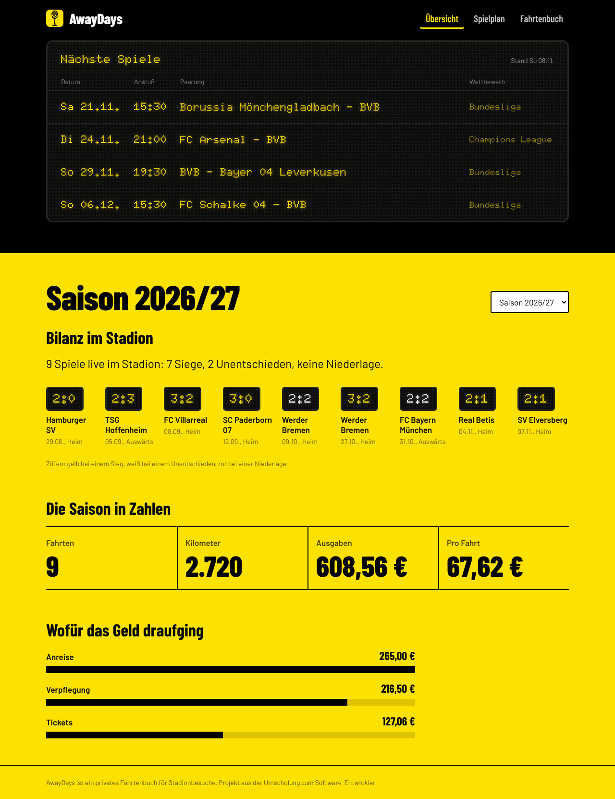
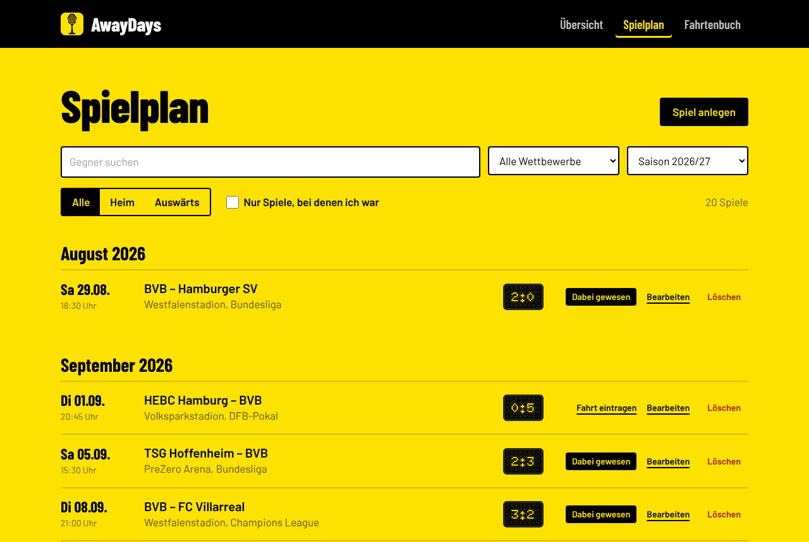
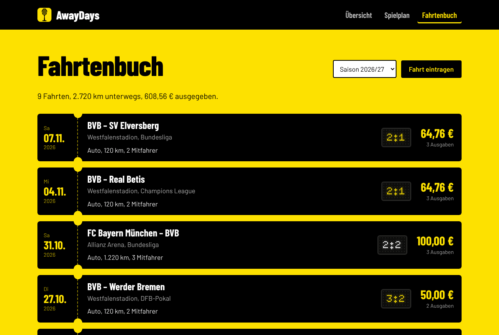
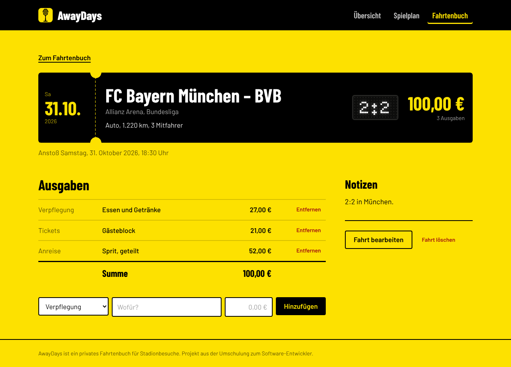

# AwayDays

Fahrtenbuch für Stadionbesuche beim BVB: Spiele erfassen, Fahrten mit Ausgaben eintragen und am Ende der Saison sehen, was sie gekostet hat und wie der BVB spielt, wenn ich im Stadion bin.

Projekt aus der Umschulung zum Software-Entwickler bei der WBS (Kapitel 20, ASP.NET): Fullstack mit CRUD im Backend und im Frontend.



## Funktionen

- **Spielplan:** Spiele anlegen, bearbeiten und löschen. Suche nach Gegner, Filter nach Wettbewerb, Saison, Heim oder auswärts und „nur Spiele, bei denen ich war“.
- **Fahrtenbuch:** Fahrten zu einem Spiel mit beliebig vielen Ausgaben anlegen, bearbeiten und löschen. Ausgaben einzeln hinzufügen und entfernen.
- **Übersicht:** Anzeigetafel mit den nächsten Spielen, Bilanz der Spiele im Stadion, Kilometer, Kosten pro Fahrt und Kosten nach Kategorie.
- **Saubere Fehler:** Jede Fehlerantwort der API ist ein ProblemDetails-Objekt. Das Frontend zeigt Validierungsfehler direkt am Formularfeld an.

| Spielplan | Fahrtenbuch |
| --- | --- |
|  |  |

## Technik

| Teil | Technik |
| --- | --- |
| Backend | .NET 10 Minimal API, EF Core 10 mit SQLite, DataAnnotations-Validierung, ProblemDetails, OpenAPI und Scalar |
| Frontend | React 19, Vite, TypeScript, React Router, Tailwind CSS 4 |

## Starten

**Backend** (Terminal 1):

```bash
cd backend
dotnet tool restore
dotnet run --project AwayDays
```

Die API läuft auf `http://localhost:5100`, die API-Dokumentation auf `http://localhost:5100/scalar`. Im Development-Modus werden beim Start die Migrationen angewendet und Startdaten eingetragen, falls die Datenbank leer ist.

Datenbank zurücksetzen, damit die Startdaten neu eingetragen werden:

```bash
dotnet ef database drop --project AwayDays --force
dotnet run --project AwayDays
```

**Frontend** (Terminal 2):

```bash
cd frontend
npm install
npm run dev
```

Die App läuft auf `http://localhost:5173`. Die API erlaubt diesen Ursprung per CORS.

Zum Ausprobieren der API ohne Frontend gibt es `backend/AwayDays/AwayDays.http` mit Beispielanfragen.

## Datenmodell

```
Match (Spiel)  1 ──── n  Trip (Fahrt)  1 ──── n  Expense (Ausgabe)
```

- **Match:** Anstoß, Gegner, Stadion, Wettbewerb, Heim oder auswärts, Ergebnis (leer, solange nicht gespielt)
- **Trip:** Anreise, Kilometer, Mitfahrer, Notizen
- **Expense:** Kategorie, Beschreibung, Betrag

Ein Spiel mit Fahrten kann nicht gelöscht werden (`Restrict`, die API antwortet mit 409). Wird eine Fahrt gelöscht, verschwinden ihre Ausgaben mit (`Cascade`). Enums werden als Text gespeichert, Beträge mit `HasPrecision(18, 2)`, Zeitstempel über einen Value Converter, damit SQLite sie sortieren und vergleichen kann.

## API

| Methode | Route | Antworten |
| --- | --- | --- |
| GET | `/api/matches?q=&competition=&season=&isHome=` | 200 |
| GET | `/api/matches/{id}` | 200, 404 |
| POST | `/api/matches` | 201, 400 |
| PUT | `/api/matches/{id}` | 200, 400, 404 |
| DELETE | `/api/matches/{id}` | 204, 404, 409 |
| GET | `/api/trips?season=` | 200 |
| GET | `/api/trips/{id}` | 200, 404 |
| POST | `/api/trips` (mit Liste `expenses`, ein `SaveChangesAsync`) | 201, 400 |
| PUT | `/api/trips/{id}` | 200, 400, 404 |
| DELETE | `/api/trips/{id}` | 204, 404 |
| POST | `/api/trips/{tripId}/expenses` | 201, 400, 404 |
| DELETE | `/api/trips/{tripId}/expenses/{expenseId}` | 204, 404 |
| GET | `/api/reports/season?season=2026` | 200, 400 |

Alle Ids haben die Routen-Einschränkung `{id:guid}`, ein Endpoint-Filter lehnt leere Guids ab.

## Projektvorgaben

Als Checkliste dienten die Anforderungen aus dem Modulprojekt „Restaurant Orders“, übertragen auf das eigene Thema.

| Anforderung | Umsetzung |
| --- | --- |
| Solution, Minimal API | `AwayDays.slnx`, Endpunkte mit `MapGroup` |
| EF Core mit SQLite, Tool-Manifest | `dotnet-tools.json`, `ApplicationDbContext`, Services als Scoped registriert |
| Datenbankdesign mit Fluent API | Längen, Dezimalgenauigkeit, Enum als Text, Index auf `KickOff`, `Restrict` und `Cascade` |
| Migration und Seeding | `InitialCreate`, `MigrateAsync` und `DbSeeder` beim Start im Development-Modus |
| CRUD mit korrekten Statuscodes | Spiele, Fahrten und Ausgaben, `TypedResults` mit `Results<...>` |
| Suche und Filter | Abfrage wird schrittweise aufgebaut, Suche über `EF.Functions.Like` |
| Anlegen mit Positionen in einem Schritt | Fahrt plus Ausgaben mit einem `SaveChangesAsync` |
| Projektionen in DTOs | `Select` direkt in Response-DTOs, Join über Navigation Properties |
| Bericht in der Datenbank | Kosten nach Kategorie mit `GroupBy` und `Sum` |
| DTOs und Validierung | DataAnnotations mit deutschen Meldungen, `AddValidation()` |
| Fehlerbehandlung | `GlobalExceptionHandler`: 409 für Konflikte und Datenbankfehler, 500 ohne Stacktrace |
| Scalar und OpenAPI | Jeder Endpunkt mit Name, Zusammenfassung und möglichen Antworten |
| Projektstruktur | `Endpoints/`, `Dtos/`, `Models/`, `Services/`, `Data/`, `Errors/`, `Filters/` |
| Frontend mit CRUD | React-Seiten für Spiele, Fahrten und Ausgaben |

## Design

Die Grundfläche ist das BVB-Gelb, schwarz sind nur Kopf, Anzeigetafel und Tickets. Die nächsten Spiele stehen auf einer Anzeigetafel in Punktmatrix-Schrift (Doto), die beim Laden einmal wie eine Fallblatt-Anzeige durchblättert. Dieselbe Schrift zeigt die Ergebnisse, die Farbe der Ziffern verrät den Ausgang aus BVB-Sicht. Fahrten erscheinen als Eintrittskarten mit Abriss. Text ist in Barlow gesetzt. Das Emblem ist der Flutlichtmast des alten Westfalenstadions als eigene Zeichnung, kein Vereinslogo.

Die Seiten funktionieren ab 360 px Breite, sind mit der Tastatur bedienbar und verzichten auf die Animation, wenn das System reduzierte Bewegung verlangt.



## Startdaten

Spielplan und Ergebnisse der Saison 2026/27 sind echt (Stand 8. November 2026, Quellen: hessenschau.de, uefa.com, dfb.de, bvb.de). Die Fahrten sind meine Stadionbesuche mit meinen Kosten: Dauerkarte 310 € für 21 Heimspiele (17 Bundesliga, 4 Champions League), also 14,76 € pro Spiel, dazu pro Heimspiel 50 € für Bulli und Verpflegung, Hoffenheim 70 €, München 100 €. Die Kilometer sind Schätzwerte.
